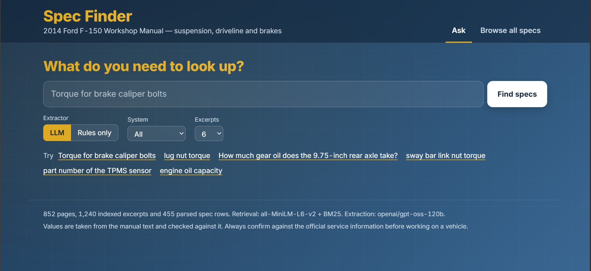
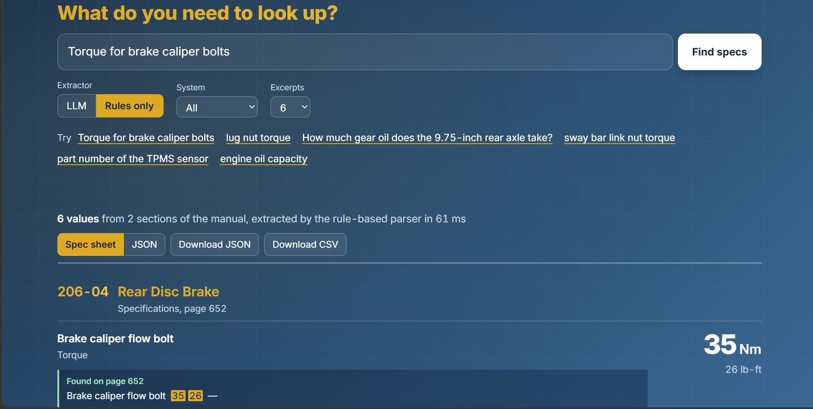
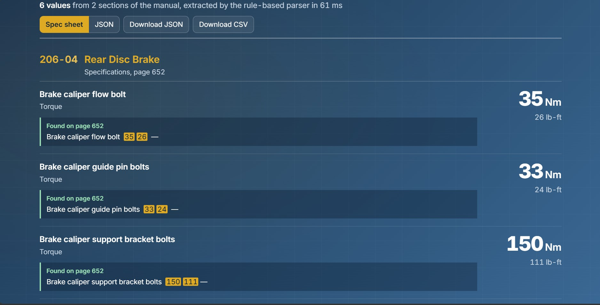
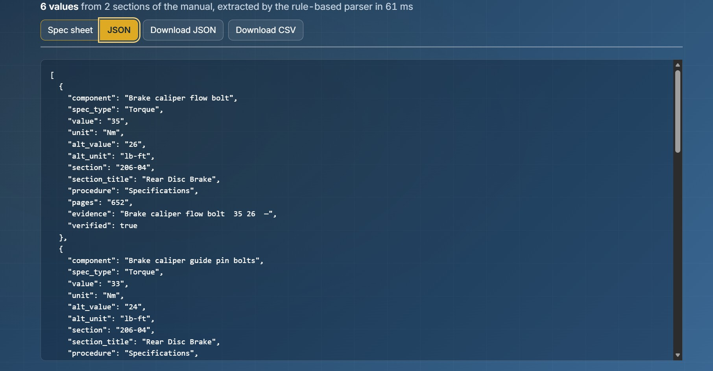
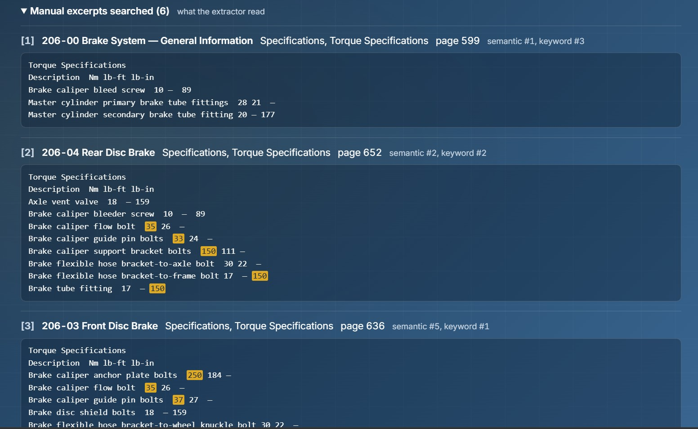
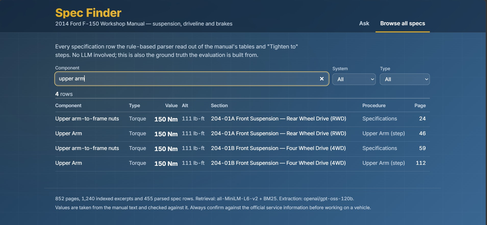

# Vehicle Spec Extraction — F-150 Spec Finder

A retrieval-augmented pipeline that pulls structured specifications (torque values, fluid capacities, part numbers, runout and backlash limits) out of the 2014 Ford F-150 workshop manual, with a web UI on top.

```
$ specrag extract "Torque for brake caliper bolts" --format json
```

One record of the output (the full answer has one per bolt, per section):

```json
[
  {
    "component": "Brake caliper guide pin bolts",
    "spec_type": "Torque",
    "value": "33",
    "unit": "Nm",
    "alt_value": "24",
    "alt_unit": "lb-ft",
    "condition": "Rear",
    "section": "206-04",
    "section_title": "Rear Disc Brake",
    "procedure": "Specifications",
    "pages": "652",
    "evidence": "Brake caliper guide pin bolts  33 24  —",
    "verified": true
  }
]
```

The first four fields are the format the assignment asks for. The rest exist so every number can be checked: which section of the manual, which page, and the exact line it was read from.



---

## Contents

1. [Quick start](#1-quick-start)
2. [What the manual actually looks like](#2-what-the-manual-actually-looks-like)
3. [Pipeline design](#3-pipeline-design)
4. [Evaluation](#4-evaluation)
5. [UI and deployment](#5-ui-and-deployment)
6. [Project layout](#6-project-layout)
7. [Limitations and ideas for improvement](#7-limitations-and-ideas-for-improvement)

---

## 1. Quick start

Requires Python 3.10+ and a free [Groq API key](https://console.groq.com/keys).

```bash
# with uv
uv sync
# or with pip
python -m venv .venv && source .venv/bin/activate   # Windows: .venv\Scripts\activate
pip install -e .

cp .env.example .env                                 # add GROQ_API_KEY
# put the manual at data/sample-service-manual.pdf (it is not in the repo)

specrag ingest                                       # ~1 min on CPU: extract, clean, chunk, embed
specrag extract "Torque for brake caliper bolts"
specrag serve                                        # UI + API on http://localhost:8000
```

Other commands:

```bash
specrag extract "brake fluid capacity" --format csv --out outputs/brake_fluid.csv
specrag batch eval/queries.txt               # many queries -> outputs/specs.json + outputs/specs.csv
specrag search "sway bar link nut"           # retrieval only: what the LLM would read
specrag extract "lug nut torque" --mode rules   # no LLM, deterministic parser only
specrag eval                                 # golden-set evaluation (section 4)
```

Without a key, everything still runs in `rules` mode (section 3.7).

---

## 2. What the manual actually looks like

The design follows from what was in the PDF, so this comes first.

| Observation | Consequence |
|---|---|
| 852 pages, but really **177 workshop-manual web pages printed to PDF**. Every page carries a browser header (`Page 2 sur 5`) and a `file:///C:/TSO/...` footer. | The noise has to go. The footer is also the only thing on a continuation page that says which document it belongs to, so it is read before it is removed. |
| Covers **only sections 204-206**: suspension, driveline, brakes. No engine or transmission. | "Engine oil capacity" has no answer in this manual. The system has to say so, not guess. |
| Specs live in **"Torque Specifications" tables** (Nm / lb-ft / lb-in columns), "General Specifications" tables, multi-line "Material" tables (fluid capacities, part codes) and inline steps ("Tighten to 35 Nm (26 lb-ft)"). | One parser doesn't fit all four. See 3.7. |
| PyMuPDF's default `get_text()` emits **one table cell per line**. "Shock absorber lower nuts", "90", "66" and "—" come out as four separate lines. | Which number is Nm and which is lb-ft is lost before any model sees it. Fixed in 3.1. |
| **The same part name appears in several sections with different values.** Caliper guide pin bolts are 37 Nm front (206-03) and 33 Nm rear (206-04). Lower shock nuts are 90 Nm, except 550 Nm on the SVT Raptor. The 9.75-inch axle takes 2.84 L, 2.60 L or 2.48 L depending on the differential. | A single "the answer" is often wrong. Every result carries its section, and variants are returned separately. |
| Some table rows hold **no value**, only "Refer to the procedure in this section". The wheel-nut torque (204 Nm) exists only inside the Wheel and Tire installation steps. | Retrieval has to follow that reference (3.5). |
| One document (**SE241B12**, SVT Raptor shock absorber) **appears twice**, pages 63-72 and 84-93, line for line identical. | It is de-duplicated at ingest. Otherwise it fills two retrieval slots with the same text. |

---

## 3. Pipeline design

```
PDF ──► 3.1 rows from word boxes ──► 3.2 clean + metadata ──► 3.3 structure-aware chunks
                                                                    │
                       ┌────────────────────────────────────────────┤
                       ▼                                            ▼
             3.4 small-to-big index                        3.7 deterministic table parser
             (chunks + table rows;                         (ground truth for eval,
              MiniLM in Qdrant + BM25)                      no-LLM fallback)
                       │
query ──► 3.5 hybrid retrieval (RRF) + reference following
                       │
                       ▼
             3.6 LLM extraction (JSON) ──► grounding check ──► JSON / CSV / UI
```

### 3.1 PDF text extraction: rows, not cells (`specrag/pdf_text.py`)

PyMuPDF, but from word coordinates instead of `get_text()`:

1. Group words whose vertical centres are within 3 pt.
2. Sort each group left to right.
3. Write any horizontal gap wider than 12 pt as a double space (a column break).

```
Before:  Shock absorber lower nuts \n 90 \n 66 \n —
After:   Shock absorber lower nuts  90 66  —
```

This happens before chunking, embedding or prompting, and it matters more than any of them. No prompt can recover column alignment that was thrown away at extraction. Pages with no text layer fall back to Tesseract OCR through PyMuPDF. This manual has text on all 852 pages, so the fallback never fires here, but it does for scanned manuals.

### 3.2 Cleaning (`specrag/clean.py`)

- Strips the browser header and the `file:///` footer. The footer's document ID (`SE241A01.HTM`) is kept as metadata first.
- Reads `SECTION 204-01A: Front Suspension — Rear Wheel Drive (RWD)` and the document type (`SPECIFICATIONS`, `REMOVAL AND INSTALLATION`, ...) from each document's first page and carries them to its continuation pages.
- Replaces the manual's bullet glyph, which extracts as a stray `z`, and removes watermark text.
- Drops exact duplicate documents.

### 3.3 Chunking: the manual's structure, not a character count (`specrag/chunk.py`)

A generic text splitter cuts a torque table after row 7 of 15. The rows below the cut lose their column header, and the model has to guess units. Instead:

- **A chunk never crosses a document boundary.** It never mixes RWD and 4WD sections.
- **Blocks start at headings** (`Torque Specifications`, `Removal`, `Installation`, ...) and at any line directly above a table header row.
- **Spec tables are atomic**: one table, one chunk.
- **Tables end where prose resumes.** A "Material" table at the top of a procedure has no closing heading; the steps just start. The first version of the chunker produced a 6,375-character "table" that was really a whole brake inspection procedure. Ending the table at the first numbered step, NOTE or bullet fixed that. The largest chunk is now 1,280 characters.
- **Prose is packed to ~900 characters**, cutting just before a numbered step where possible, with 2 lines of overlap.
- **Every chunk gets a context header**, used both for embedding and in the LLM prompt:

  ```
  Section 206-04: Rear Disc Brake | Specifications | Specifications | Torque Specifications
  ```

Result: 1,240 chunks from 176 documents (80 spec tables, 46 other tables, 1,114 prose chunks).

### 3.4 Indexing: small-to-big (`specrag/index.py`)

The first index had one MiniLM vector per chunk. **Dense retrieval alone found the expected table row only 47% of the time.** A Torque Specifications chunk packs 15 bolts into one vector, so a question about one bolt lands closer to a removal procedure that mentions it in passing.

The fix: index **every table row as its own retrieval unit**, prefixed with the chunk's context header and the table's column header. Retrieval scores these small units but returns the parent chunk, so matching works on the row while the LLM still reads the whole table. **Dense row recall went from 47% to 89%.**

- Vectors: `all-MiniLM-L6-v2` (384-dim) in Qdrant, embedded local mode (no account, no Docker). Set `QDRANT_URL` to use Qdrant Cloud instead.
- BM25 over the same units (`rank-bm25`), rebuilt in memory at startup (~0.1 s).

### 3.5 Retrieval: hybrid + reference following (`specrag/retrieve.py`)

- **Hybrid with Reciprocal Rank Fusion** (k = 60). Spec questions are mostly exact part names, which BM25 matches literally and a small embedding model blurs. Paraphrases like "how tight do the wheel nuts go" are the reverse. RRF merges the two ranked lists without having to calibrate cosine scores against BM25 scores.
- **Query expansion for BM25**: a small table of technician-to-manual vocabulary, such as "sway bar" to "stabilizer bar", "lug nut" to "wheel nuts" and "rotor" to "brake disc". Every entry is a mismatch actually observed on this manual.
- **Spec-table boost**: when the query asks for a spec, spec-table chunks get +0.001 in fused score. The value was measured (section 4). Larger boosts change nothing in the eval but bury the procedure chunks that "Refer to the procedure" rows point to.
- **Reference following**: if a retrieved table has a row like `Wheel nuts a — —` (footnote "Refer to the procedure in this section") for the component being asked about, the best procedure chunk from the same section that contains a "Tighten to" is appended. That is how "lug nut torque" finds 204 Nm.

### 3.6 LLM extraction and the grounding check (`specrag/extractor.py`)

The model is `openai/gpt-oss-120b` on Groq, in JSON mode at temperature 0. The assignment suggests Llama-3, but Groq retired `llama-3.3-70b-versatile` and `llama-3.1-8b-instant` on 2026-08-16 and recommends gpt-oss as the replacement. Any Groq model can be set with `SPECRAG_LLM_MODEL`.

The model is only trusted with what it is good at: reading messy excerpts and deciding which rows answer the question. Everything else is attached or checked in code:

- **Prompt rules**: use only the excerpts; return each variant (front/rear, RWD/4WD, Raptor, axle size) as a separate item with a `condition`; copy numbers exactly; skip "Refer to the procedure" rows; cite the excerpt number.
- **Citations come from metadata, not the model.** Section, page and procedure are attached from the cited chunk, so they cannot be hallucinated.
- **Grounding check.** Every value must appear as a whole token (35 does not match 135 or 3.5) in the excerpt the model cited:
  - If it is in a different retrieved excerpt instead, the citation is corrected.
  - If it is in none, the item goes to `rejected` with a reason. The UI shows rejected items rather than hiding them, so they serve as evidence that the check works.
- **Malformed items** that fail Pydantic validation are rejected individually instead of failing the whole response.
- **Value and unit are separated.** The manual prints some capacities with the unit attached ("1.66L", "32mm"), and the model copies them verbatim, as the prompt asks. Those are split into value `1.66` and unit `L` before the grounding check, so the JSON and CSV carry clean numbers. The first full eval run found this: 5 correct answers had been scored as wrong.
- **Rate limits are waited out, not fatal.** Groq's free tier allows 8,000 tokens per minute for this model, and one call uses about 2,500, so only about 3 calls fit per minute. `llm.py` sleeps for as long as Groq asks, up to `SPECRAG_LLM_RATE_LIMIT_WAIT` seconds (120 by default).
- The source line becomes `evidence`. The UI highlights the value inside it.

### 3.7 The deterministic parser (`specrag/spec_tables.py`)

Regex parsing of torque tables (one row per line, fixed unit columns), General Specifications rows, inline "Tighten to" steps, part-number tables and, best-effort, the fluid capacities in Material tables. It finds 455 spec rows. It has three jobs:

1. **Ground truth.** `eval/generated.json` (89 queries) is built from it.
2. **Baseline.** `--mode rules` answers from these rows alone, so the LLM has something measurable to beat.
3. **Fallback.** No key, or quota exhausted: the UI still answers.

It deliberately does not attempt the Material tables properly. There, the PDF interleaves three columns over four lines:

```
Motorcraft® High Performance  WSS-M6C62-A 1,420 ml
DOT 3 Motor Vehicle Brake  or WSS-M6C65- (3.0 pt)
Fluid (US) / Motorcraft® Brake  A1
```

Rules where the layout is regular, the model where it is not.

---

## 4. Evaluation

```bash
specrag eval                    # retrieval for 3 methods + extraction for rules and llm
specrag eval --retrieval-only   # no API calls
```

**Golden set**

- `eval/handwritten.json`: 19 questions phrased the way a technician asks. The expected values were checked by hand against the manual, and the page is noted for each. Includes the variant traps from section 2 and 4 questions whose correct answer is "not in this manual".
- `eval/generated.json`: one question per distinct torque-table component (89), generated from the parser. Wide coverage, but it uses the manual's exact wording, which flatters BM25. That's why the two sets are reported separately.

### Retrieval: row recall@6

The metric is the share of expected source rows that appear in the 6 retrieved chunks. The LLM can't extract what it never sees.

| Method | All (104) | Handwritten (15) | Generated (89) |
|---|---|---|---|
| Dense (MiniLM), chunk-level vectors only | 47.0% | — | — |
| Dense (MiniLM), small-to-big | 88.9% | 80.0% | 90.5% |
| BM25 | 96.6% | 80.0% | 99.4% |
| **Hybrid (RRF) + reference following** | **98.6%** | **100%** | **98.3%** |

Neither method is enough alone on the questions people actually type: dense and BM25 each reach 80% on the handwritten set, and they miss different questions.

### Extraction: precision / recall over (value, section) pairs

49 questions: the 19 handwritten ones plus 30 generated ones sampled with a fixed seed.

A value from the wrong section, such as the 4WD value for an RWD question, counts as wrong. Returning a whole torque table when one row was asked for counts as false positives.

| Extractor | Precision | Recall | F1 | Handwritten P / R | Generated P / R | Refusal accuracy |
|---|---|---|---|---|---|---|
| Rules (no LLM) | 56.8% | 92.7% | 70.4% | 67.6% / 92.0% | 51.9% / 93.0% | 4/4 |
| **LLM (`gpt-oss-120b`) + grounding** | **71.1%** | **94.1%** | **81.0%** | **100% / 96.0%** | **60.6% / 93.0%** | **4/4** |

What the numbers mean:

- **On the handwritten questions, the LLM returned no wrong values** and missed one: the 2.48 L fill for a Traction-Lok 9.75-inch axle (it returned the other two of the three). The rules baseline finds the right rows too, but returns their neighbours along with them. It cannot tell front from rear, or the 9.75-inch axle from the 8.8-inch. That precision gap is the LLM's job. Two cases where the difference is plain:
  - "lug nut torque": rules gave the 40 Nm wheel hub nut, the LLM the correct 204 Nm from the Wheel and Tire procedure.
  - "ring gear backlash for the 9.75 inch axle": rules gave 5 values from three axles, the LLM only the 9.75-inch one.
- **Generated-set precision is understated by design.** Its gold answers match the part name exactly. So for "torque for brake tube fitting", correct rows for the *primary* and *secondary* brake tube fittings, and the same bolt listed again in another section, all count as false positives. Most of the 60.6% is this.
- **No answer reached the output that wasn't in the manual.** The grounding check had nothing to reject on this run; every value the model returned was found in its cited excerpt.
- **The 4 out-of-manual questions** (engine oil, spark plugs, transmission fluid, cylinder head bolts) all correctly returned nothing, in both modes.

**Caveats, stated plainly**

- The retrieval settings (row units, table boost, query expansions, reference following) were developed against this same golden set. There is no held-out split, so expect somewhat lower numbers on new questions.
- The handwritten set is small (19 questions). Treat its percentages as directional.
- Two expected answers were added after the first LLM run, when the model returned values the golden set had missed. Both were checked against the manual before being accepted: 80 Nm for the stabilizer bar link nuts in Camber and Caster Adjustment step 13, and 25 Nm for the master cylinder nuts in the 206-07 table. They are listed as `accept_also` in `eval/handwritten.json`, with notes.
- The LLM is sampled at temperature 0, but Groq does not guarantee identical output between runs, so re-runs can differ by a question or two.
- `eval/results.json` holds the full per-question report from the last run.

---

## 5. UI and deployment

The UI (`frontend/`) is plain HTML, CSS and JS with no build step:

- **Ask**: results are grouped by manual section, so front and rear (or RWD and 4WD) read apart at a glance. Each value shows the manual line it came from, with the value highlighted.
- Also on the Ask view:
  - Rules / LLM toggle and a system filter
  - a JSON view in the assignment's format
  - JSON and CSV downloads
  - the retrieved excerpts, with their semantic and keyword ranks
  - any answers the grounding check rejected
- **Browse all specs**: every row the deterministic parser found, filterable by component, system and spec type.

Locally, `specrag serve` serves the UI and the API together on one port.

### Screenshots

| | |
|---|---|
|  |  |
| **Torque for brake caliper bolts.** Front (206-03) and rear (206-04) are separate groups, and each value shows the manual line it came from. | The rest of the same answer. |
|  |  |
| **JSON view**, in the assignment's output format, ready to download as JSON or CSV. | **Manual excerpts searched**: what the extractor read, with each excerpt's semantic and keyword rank. |
|  | |
| **Browse all specs**: every row the deterministic parser found, filtered here to fluid capacities. | |

These were taken in Rules mode while the Groq free-tier daily quota was used up. LLM mode looks the same and fills in the Condition column (Front / Rear, RWD / 4WD, SVT Raptor).

### Hosting: Vercel for the UI, Hugging Face Spaces for the API

The API has to embed each query with the same MiniLM model that embedded the manual, which needs PyTorch at request time. That is far over the serverless function size limits on both Vercel and Netlify. So:

| Part | Where | Why |
|---|---|---|
| UI (`frontend/`) | **Vercel** (static) | Free, instant, global CDN. Netlify would work identically for static files. |
| API (`api/`, `specrag/`, `index/`) | **Hugging Face Space** (Docker, free CPU) | Runs PyTorch. The model is baked into the image, and the index loads from `index/vectors.npz` (2.4 MB) so the Space never needs the PDF. |

**Deploy the API**

1. On your machine, build the deploy bundle:
   ```bash
   specrag ingest && specrag export-index
   ```
2. Create a Space at huggingface.co/new-space with SDK **Docker** and hardware **CPU basic**.
3. Assemble the Space folder:
   ```bash
   bash deploy/make_space.sh ../f150-spec-finder-space
   ```
   On Windows: `powershell -ExecutionPolicy Bypass -File deploy\make_space.ps1 ..\f150-spec-finder-space`
4. Push that folder to the Space's git repo.
5. In the Space's **Settings → Variables and secrets**, add:
   - `GROQ_API_KEY`
   - `SPECRAG_CORS_ORIGINS` = your Vercel URL
   - `SPECRAG_LLM_RATE_LIMIT_WAIT` = `20`, so a visitor who hits the free-tier limit gets a "quota used up" message instead of a two-minute wait
6. Check that `https://<user>-<space>.hf.space/api/health` returns `{"status":"ok"}`. The Space also serves the UI at `/`, so it works on its own.

**Deploy the UI**

1. Set the API URL in `frontend/config.js`:
   ```js
   window.SPECRAG_API_BASE = "https://<user>-<space>.hf.space";
   ```
2. Deploy the folder with either option:
   - `cd frontend && npx vercel --prod`
   - or import the GitHub repo in Vercel with **Root Directory = `frontend`** and no build command.

**About the data**: the manual and anything that contains its text (`data/`, `build/`, `index/`) are git-ignored. It's Ford's copyrighted material, provided for this assignment. The index goes to the Space, not to GitHub.

---

## 6. Project layout

```
specrag/
  config.py        every tunable, env-driven, with the reasoning next to it
  pdf_text.py      PDF -> visual rows (word boxes), OCR fallback
  clean.py         header/footer removal, section metadata, de-duplication
  chunk.py         structure-aware chunking
  spec_tables.py   deterministic spec parser (ground truth, baseline, fallback)
  embed.py         sentence-transformers embedder behind a Protocol
  index.py         retrieval units (small-to-big), Qdrant, BM25, deploy export
  retrieve.py      hybrid RRF, query expansion, reference following
  llm.py           Groq JSON-mode call
  extractor.py     prompt, grounding check, rules mode
  evaluate.py      golden-set retrieval + extraction metrics
  output.py        JSON / CSV writers
  pipeline.py      ingest orchestration
  cli.py           `specrag` command
api/main.py        FastAPI: /api/extract, /api/search, /api/specs, /api/meta + static UI
frontend/          UI (index.html, styles.css, app.js, config.js)
eval/              handwritten.json, generated.json, queries.txt, results.json
deploy/            Hugging Face Space Dockerfile + assembly scripts
```

Intermediate outputs are written to `build/` as JSON (`pages.json`, `chunks.json`, `tables.json`), so each stage can be inspected on its own.

---

## 7. Limitations

- **Text only.** Values printed inside diagrams (callouts, exploded views) are not extracted, as the assignment scoped.
- **Wrapped component names** in part tables are sometimes cut at the line break, for example "TPMS sensor (a new" in the rules output. The LLM path reads the full excerpt and is not affected.
- **Rules mode can be confidently wrong on paraphrases.** For "lug nut torque" it returns the 40 Nm wheel hub nut, because it only matches words. This is why it is the baseline and fallback rather than the main path.
- **Retrieval depth.** "Brake hose bracket bolt(s)" appears in 7 sections, and 6 excerpts are retrieved, so some sections are never seen. Raising `--top-k` fixes it per query at the cost of a longer prompt.
- **Free-tier quota.** Groq's free tier allows about 3 LLM queries per minute and 200,000 tokens per day (roughly 70 queries). If the live demo shows "daily token limit reached", Rules mode still works and the quota refills over the following 24 hours. A paid tier or a separate key for the deployed API removes the limit.

